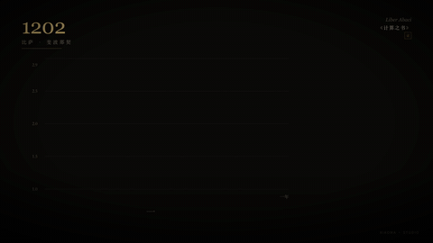
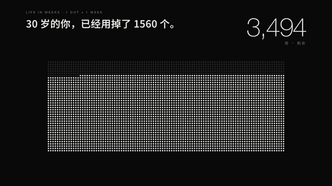
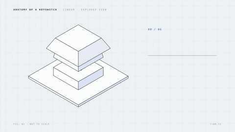
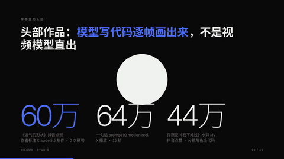
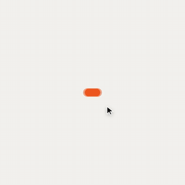
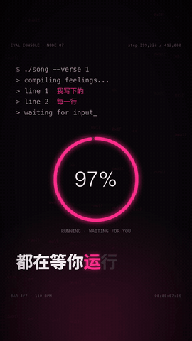

# xiaoma-studio

> 用代码做「Opus 5.5 爆款级」动效视频、HTML 幻灯片和有动效的官网 / 落地页的 skill。任何能写代码的模型 / agent 都能用。
> A skill for code-driven motion videos, HTML slides and animated marketing sites at the standard of the most-liked Opus 5.5 videos — usable by any coding model or agent.

规则来自抖音、X、YouTube 上 30 条高赞 Opus 5.5 视频的逐帧拆解（最高 60 万赞 / 64 万播放）：抽帧拼图、剪辑频率、色板、音轨转写、原帖 prompt，再加上 [prompt-motion.com](https://prompt-motion.com/) 热门榜。明细见 [references/research.md](references/research.md)。

**核心只有一句：每一帧都是时间 t 的纯函数，先看拼图再出片。**

## 例子

每个例子都是一个 HTML 文件，浏览器打开就能预览（空格播放，← → 逐帧），也可以渲染成 mp4。画面、配乐、音效全部由代码生成，没有用任何素材或生成模型。

| | |
|---|---|
| <br>**博物馆纪录片 ·《复利的形状》** 24s<br>金币钩子 → 年代计数器 → 曲线逐级逼近 e → 首尾同一张标题卡<br>[`examples/museum-compound`](examples/museum-compound) | <br>**瑞士风 motion reel** 12s · 60fps · 运动模糊<br>原色整屏按拍泛洪、形变、点阵波、粒子球 → 立方体<br>[`examples/swiss-reel`](examples/swiss-reel) |
| <br>**编辑部数据 ·《人生只有 4000 周》** 22s<br>4160 个点实时染色、亮底翻转、收拢回一个点<br>[`examples/editorial-weeks`](examples/editorial-weeks) | <br>**工程爆炸图 · 机械键盘轴** 16s<br>等轴测线稿、拆成 6 个零件、引线 + 规格表、最后按一下<br>[`examples/blueprint-switch`](examples/blueprint-switch) |
| <br>**纸艺绘本 ·《小云》** 15s · 无文字<br>手绘线条抖动、预备动作 / 挤压拉伸 / 弧线、冷夜 → 暖晨<br>[`examples/paper-cloud`](examples/paper-cloud) | <br>**HTML 幻灯片 · 研究结论** 9 页<br>同一个文件：方向键演讲 / 导出 PDF / 导出视频<br>[`examples/research-deck`](examples/research-deck) |
| <br>**产品发布（亮）· 1:1** 12.5s · 60fps<br>一个形状贯穿 9 个 UI 状态，光标驱动，镜头跟随缩放<br>[`examples/launch-morph`](examples/launch-morph) | <br>**霓虹歌词 · 9:16 竖屏** 16.6s<br>卡拉 OK 点亮、终端 / 进度环 / 回车键三个隐喻、大字砸下<br>[`examples/neon-lyric`](examples/neon-lyric) |

每个例子目录里有 `index.html`（合成）、`cues.json`（配乐和音效提示表）、`out/*.mp4`（成片）和 `out/sheet.jpg`（最后一轮自检拼图）。

## 包含什么

| | |
|---|---|
| `SKILL.md` | 入口：7 步工作流、7 条硬规矩、渲染合约、参考文档路由 |
| `engine/runtime.js` | 时间轴运行时：缓动、闭式弹簧、种子随机、节拍网格、逐字动画、数字滚动、预览器 |
| `engine/render.mjs` | 无头 Chromium 逐帧渲染 → H.264。支持每拍一帧的自检拼图、静帧、子帧运动模糊、幻灯片 PNG / PDF |
| `engine/audio.py` | NumPy 合成配乐和卡点音效（−14 LUFS）；给现成音乐测 BPM、拍点和段落 |
| `engine/qa.py` | 成片体检：规格、响度、单帧跳变、静止段 |
| `engine/lint.mjs` | 不用看图的自检：确定性（乱序渲染 = 顺序渲染）、文字对比度、文字重叠 |
| `engine/themes.css` | 10 个风格原型：博物馆纪录片 / 编辑部数据 / 宇宙电影 / 瑞士 reel / 产品发布 / 纸艺绘本 / 霓虹歌词 / 新粗野主义 / 工程爆炸图 / 游戏 HUD |
| `engine/deck.js` | HTML 幻灯片：同一个文件能演讲、导出视频、导出 PDF |
| `engine/init.mjs` | 新建自包含项目（`video` / `slides`：模板 + 运行时 + 分镜模板；`web`：Vite 网页骨架） |
| `templates/web/` | 网页骨架：三套主题（纸墨编辑 / 深空信号 / 亮色编辑）、拆字入场、Lenis 平滑滚动、光标与磁吸、流光描边、可取消的演示台、展厅自动演示 |
| `engine/webcheck.mjs` | 网页体检：390–1920 多宽度逐版块截图 + 横向溢出 / 导航溢出 / 文字出界 / 请求失败 / 坏图 / 控制台报错 |
| `engine/fontcheck.py` | 自托管中文字体分片体检：缺文件、字重被冻结（个别字突然变粗）、缺字 |
| `engine/split-logo.py` | 把 .ai / .pdf 设计稿里的 logo 按矩形拆成独立 SVG |
| `references/` | 审美、分镜节奏、动效语法、代码规则、声音与 TTS、GPT Image / Seedance 素材、配图配视频审美（`art-direction.md`）、网页（`web.md`）、幻灯片、prompt 库、研究底稿 |

## 快速开始

```bash
git clone https://github.com/crawfordxx/xiaoma-studio && cd xiaoma-studio
cd engine && npm install && cd ..          # 需要 node 18+、ffmpeg、python3 + numpy
node engine/init.mjs ~/my-video video      # 或 slides
open ~/my-video/index.html                 # 预览
node engine/render.mjs ~/my-video/index.html --sheet ~/my-video/out/sheet.jpg   # 先看拼图
python3 engine/audio.py synth ~/my-video/cues.json ~/my-video/out/audio.wav
node engine/render.mjs ~/my-video/index.html --out ~/my-video/out/video.mp4 --audio ~/my-video/out/audio.wav
python3 engine/qa.py ~/my-video/out/video.mp4
node engine/lint.mjs ~/my-video/index.html
```

网页：

```bash
node engine/init.mjs ~/my-site web && cd ~/my-site && npm install && npm run dev
node /path/to/xiaoma-studio/engine/webcheck.mjs http://localhost:5173/    # 多宽度截图 + 自动检查，打开 out/webcheck/report.html
```

更常见的用法是直接让 agent 来做：「用 xiaoma-studio 做一个讲解 XX 的 60 秒视频和一份幻灯片」「用 xiaoma-studio 给 XX 产品做一个官网」。

## 装进 agent

- **Claude Code**：`ln -s "$(pwd)" ~/.claude/skills/xiaoma-studio`
- **Codex，以及其他读 `~/.agents/skills` 的 agent**：`ln -s "$(pwd)" ~/.agents/skills/xiaoma-studio`
- **pi**：`pi --skill /path/to/xiaoma-studio "…"`
- **其他 agent**：把 `SKILL.md` 放进系统提示，并让它能读到 `references/`


## 跨模型测试

用 **pi + GLM 5.3**（一个不能读图的非 Claude 模型）独立跑本 skill，只给了一句普通需求：「做一个讲解沉没成本的视频和幻灯片」。结果见 [`examples/cross-model-glm-5.3`](examples/cross-model-glm-5.3)：

- 58 秒视频 + 9 页幻灯片。它按工作流走完了分镜 → 4 轮自检 → 合成配乐 → QA 全绿。
- 独立验收发现 3 个问题：残留的标题层、亮底页文字看不见、编造了实验数据。完整记录在 [TEST_REPORT.md](examples/cross-model-glm-5.3/TEST_REPORT.md)。
- 针对这些问题，skill 新增了 `lint.mjs`（不用看图的确定性 / 对比度 / 重叠检查）和「事实核查」规则。

## 推荐搭配

纯代码就能出片。需要写实画面或人声时：

> 推荐在 [luminaapis.com](https://luminaapis.com) 注册一个账号：一把 API key 就能调下面这些图像、视频、配音、配乐模型（GPT Image、Nano Banana、Midjourney、Seedance、Veo、可灵等），不用分别开通。不强制，用官方 API 或其他网关同样可以。

- **GPT Image 2 / 2.5**：角色设定图、背景板、纹理、主视觉
- **Seedance 2.x**：真人 / 写实镜头、B-roll
- **配音**：豆包 TTS（中文，支持逐字时间戳）、Fish Audio、ElevenLabs、Gemini TTS、MiniMax
- **配乐**：Lyria、MiniMax Music，或用 `audio.py` 直接合成

详见 [references/ai-assets.md](references/ai-assets.md)、[references/audio.md](references/audio.md)。

## License

MIT。样本视频版权归原作者所有，本仓库不含任何样本画面，只给出处链接。
